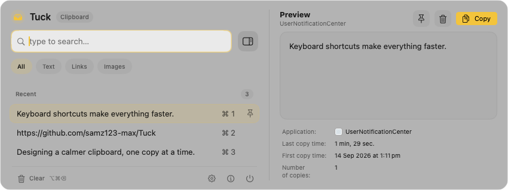
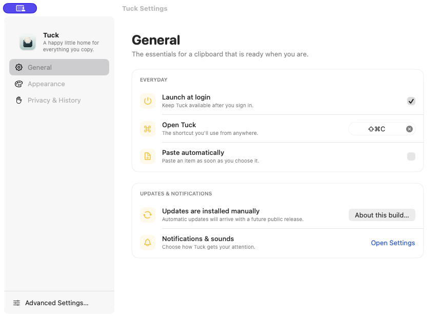

# Tuck

**A happy little home for everything you copy.**

Tuck is a native clipboard manager for macOS. It keeps a local history of copied items so they are easy to find, reuse, pin, preview, and paste.



Tuck is an independent fork of [Maccy](https://github.com/p0deje/Maccy) by Alex Rodionov and its contributors. It builds on Maccy's clipboard engine and codebase; it is not an official Maccy release. Tuck's product direction is to make that foundation feel friendlier, more modern, and more intuitive while retaining a focused native Mac experience.

## Status

Tuck is a usable personal and open-source project, published source-first. This repository does not currently provide a Developer ID-signed or notarised release, DMG, or automatic update channel. If you want to use Tuck today, build it from source.

Issues and pull requests are welcome. Maintenance, support, and feature work are best-effort, with no guaranteed response time or guarantee that a request will be implemented. Product direction remains with the maintainer, and contributions may be declined when they do not fit it.

## Highlights

- Search and filter clipboard history across all items, text, links, and images.
- Pin frequently used items and use keyboard shortcuts for fast access.
- Preview copied content and paste it with or without formatting.
- Configure history, appearance, shortcuts, and exclusions in native settings.
- Keep clipboard classification and history on the Mac; Tuck adds no account, telemetry, cloud service, or runtime AI feature.

## Screenshots



## Build from source

Requirements:

- An Apple Silicon Mac
- macOS 14 or later
- Xcode 26 or later (currently validated with Xcode 26.6)
- Internet access the first time Xcode resolves the public Swift Package dependencies

Clone the repository, open `Tuck.xcodeproj` in Xcode, select the **Tuck** scheme and **My Mac**, then build and run.

For a command-line build that does not require a signing identity:

```sh
git clone https://github.com/samz123-max/Tuck.git
cd Tuck
./tools/xcode.sh -project Tuck.xcodeproj -scheme Tuck -configuration Debug \
  -destination 'platform=macOS,arch=arm64' CODE_SIGN_IDENTITY=- \
  CODE_SIGN_STYLE=Manual DEVELOPMENT_TEAM= clean build
```

Xcode resolves the pinned dependencies from the public repositories recorded in `Package.resolved`. No private dependency, credential, or file outside the repository is required for a normal build.

## Important caveats

- Tuck stores clipboard history locally. Clipboard history can contain sensitive material, so review the exclusion settings and clear history when appropriate.
- macOS Accessibility permission is required for automatic paste. Copying and browsing history still work without it.
- Tuck uses its own `app.tuck.clipboard` bundle identifier, but currently retains Maccy's internal storage-folder name for compatibility. Quit Maccy before running Tuck and avoid running both at once.
- Updates are manual. The inherited Maccy update feed is disabled in Tuck so it cannot replace Tuck with an upstream Maccy build.
- A locally built app is not the same as a Developer ID-signed and Apple-notarised public release. Do not disable macOS security protections to install Tuck.

## How Tuck was built

Tuck is an AI-assisted software project. I define the product direction and UX, product-manage the work, direct the implementation, and test and validate the application. Much of the software implementation for the fork has been produced with AI coding tools.

I am making that process explicit because Tuck is also an experiment in what a non-software-engineer can build by treating AI as an engineering collaborator. The underlying Maccy codebase remains the work of its original authors and contributors.

## Contributing and security

See [CONTRIBUTING.md](CONTRIBUTING.md) before opening an issue or pull request. Please report suspected vulnerabilities privately as described in [SECURITY.md](SECURITY.md), not in a public issue.

## License and attribution

Tuck is distributed under the [MIT License](LICENSE). The repository preserves Maccy's original copyright and license notice. Original Maccy code and contributions remain attributable to Alex Rodionov and the Maccy contributors; Tuck-specific changes are the work of Tuck contributors.

For reference, [README-Maccy.md](README-Maccy.md) preserves the upstream project documentation present when this fork was created. For the current upstream project, visit [p0deje/Maccy](https://github.com/p0deje/Maccy).
